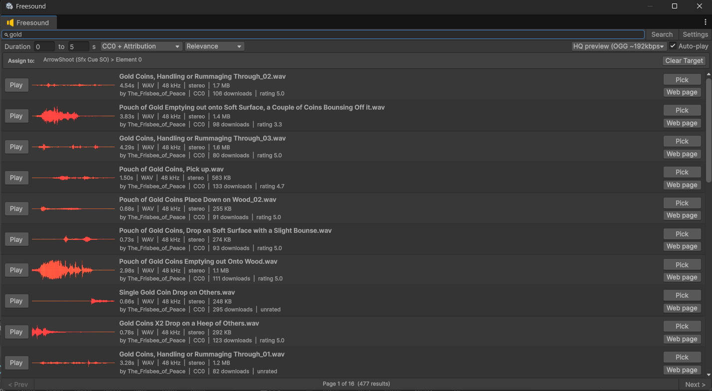

# Freesound SFX Browser for Unity

Find, audition and drop sound effects from [Freesound.org](https://freesound.org) straight into your Unity project without leaving the Inspector.

- A small search button appears next to **every AudioClip field** in the Inspector.
- Clicking it opens the **Freesound browser**: search, filter by duration/license, sort, see waveforms, and **preview** sounds instantly.
- **Pick** a sound: it is downloaded into a predefined folder (default `Assets/Audio/Freesound`), imported with sensible settings, and **assigned to the field** you came from (with Undo).
- A `FREESOUND_CREDITS.md` file is kept next to the sounds so you can credit authors (required for CC BY sounds).

Editor-only: nothing from this package ends up in your builds.

---

## 1. Requirements

- Unity **2021.3 LTS or newer**
- A free [Freesound account](https://freesound.org/home/register/)
- Internet access from the editor

The package depends on `com.unity.nuget.newtonsoft-json` (Unity's official Json.NET package). Package Manager installs it automatically.

---

## 2. Install the package

Pick one of these:

**A. From disk (simplest)**
1. Open your game project in Unity.
2. `Window > Package Manager` > `+` (top-left) > **Add package from disk...**
3. Select the `package.json` at the root of this repo.

**B. From a git URL** (after you push this repo somewhere)
1. `Window > Package Manager` > `+` > **Add package from git URL...**
2. Paste your repo URL, e.g. `https://github.com/<you>/FreesoundBrowser.git`

**C. Embedded**
Copy this whole folder into your project's `Packages/` folder (e.g. `Packages/com.alalmia.freesound-browser/`).

After installing, Unity compiles the `FreesoundBrowser.Editor` assembly. If you see errors about `Newtonsoft`, open Package Manager and make sure **Newtonsoft Json** (`com.unity.nuget.newtonsoft-json`) is installed.

---

## 3. Get your Freesound credentials

Freesound has two authentication levels ([official docs](https://freesound.org/docs/api/authentication.html)):

| What you want | What you need |
|---|---|
| Search, preview, install HQ previews (OGG ~192 kbps / MP3 ~128 kbps) | **API key** only |
| Install the **original** uploaded file (WAV/AIFF/...) | API key **plus** a one-time **OAuth2 login** |

HQ previews are good enough for most game SFX. Use originals when you need lossless source files.

### 3.1 Create an API credential (required)

1. Log in to Freesound, then open **https://freesound.org/apiv2/apply**.
2. Fill in the form:
   - **Name**: anything, e.g. `Unity SFX Browser`
   - **Description**: e.g. `Unity editor tool to search and import sounds`
   - **Callback URL** (needed for OAuth2 later): use Freesound's own page, so the code is shown on screen:
     `https://freesound.org/home/app_permissions/permission_granted/`
     (if the form suggests a different "Freesound as redirect" URL, use that one instead)
   - Accept the terms of use.
3. Submit. A new row appears in the credentials table. Note its two values:
   - **Client id**: a short string. Only needed for OAuth2.
   - **Client secret/Api key**: a long alphanumeric string. This is your **API key**.

### 3.2 Enter the API key in Unity

1. `Edit > Preferences > Freesound Browser` (macOS: `Unity > Settings > Freesound Browser`)
2. Paste the **Client secret/Api key** into **API Key**.
3. Click **Test API Key**. You should see "API key works...".

You can now search, preview and install HQ previews.

### 3.3 (Optional) Log in with OAuth2 for original-quality downloads

1. In the same Preferences page, paste the **Client id** into **Client ID**.
   Leave **Client Secret** empty: Freesound's client secret is the same value as the API key, so the API key is used.
2. Click **Open Freesound authorization page**. Your browser opens Freesound. Log in if asked, then click **Authorize!**.
3. Freesound shows an **authorization code**. Copy it, or copy the whole URL from the address bar; both work.
4. Back in Unity, paste it into **Step B: Code** and click **Complete Login** within **10 minutes**. Each code works only once.
5. You'll see "Logged in as <your user>".

Access tokens last 24 hours. The tool refreshes them automatically with the refresh token, so you normally log in only once per machine. If you revoke access on Freesound (Settings > API apps), log in again.

### Where are credentials stored?

In Unity **EditorPrefs** on your machine (on Windows: the registry under `HKCU\Software\Unity Technologies\Unity Editor 5.x`). They are **never written into the project**, so they never end up in git. Each team member uses their own key.

---

## 4. Configure the project (optional)

`Edit > Project Settings > Freesound Browser`. These settings are saved to `ProjectSettings/FreesoundBrowserSettings.json` and shared with your team:

| Setting | Default | Meaning |
|---|---|---|
| Install Folder | `Assets/Audio/Freesound` | Where picked sounds are saved (must be inside `Assets`) |
| Default Install Quality | HQ preview (OGG) | OGG preview, MP3 preview, or Original (needs OAuth2) |
| Write FREESOUND_CREDITS.md | On | Keeps an attribution table in the install folder |
| Apply Import Presets | On | New short clips use *Decompress On Load*, longer ones *Compressed In Memory* |
| Short Clip Threshold | 2 s | Boundary used by the presets |
| Force Mono On Short Clips | On | Short SFX imported as mono |
| Show Button On AudioClip Fields | On | Turns the Inspector button on or off |
| Close Browser After Pick | On | Closes the browser once the clip is assigned |
| Auto-play On Select | On | Selecting a row plays its preview |
| Min/Max Duration, License Filter, Sort Order, Results Per Page | 0-5 s, CC0 + Attribution, Relevance, 30 | Browser defaults |

---

## 5. Daily usage

### From any AudioClip field
1. Select an object whose component has an `AudioClip` field (or a list/array of them).
2. Click the **search icon** right of the field.
3. The browser opens, pre-filled with a guess from the field name (`jumpSound` searches "jump").
4. Type to refine. Search runs automatically as you type.
5. **Click a row** to hear it (auto-play), or press **Play/Stop**.
6. Click **Pick**, double-click the row, or press **Enter**. The sound is downloaded, imported and assigned. **Ctrl+Z** undoes the assignment.

### AudioSource components
Unity's built-in AudioSource inspector doesn't use custom field drawers, so you have two other entry points:
- the **Find AudioSource Clip on Freesound...** button in the GameObject header (top of the Inspector), or
- the AudioSource component's **context menu (three dots) > Find Clip on Freesound...**

### Standalone
`Window > Audio > Freesound Browser`. With no target field, **Install** just downloads the sound and pings it in the Project window.

### Keyboard
| Key | Action |
|---|---|
| Enter (in search box) | Search now |
| Up / Down | Move selection |
| Space | Play / stop selected preview |
| Enter | Pick selected sound |

### Filters
- **Duration**: min-max in seconds (0 = no limit). The default 0-5 s suits SFX.
- **License**: *CC0 only* (no attribution needed), *CC0 + Attribution* (default, commercial-safe with credits), or *Any* (includes **NonCommercial**, which you can't use in commercial games).
- **Quality** (right side): what gets installed when you pick.

### Installed files
- Named `<sound_name>_<freesoundId>.<ext>`, e.g. `Laser_Shot_12345.ogg`.
- If a sound with the same Freesound id is already in the install folder, the existing asset is reused (no duplicate download).
- The importer's `userData` stores `freesound:<id>`, so you can always trace a clip back to its source.
- Preview audio is cached in `Library/FreesoundCache` (not versioned; safe to delete).

---

## 6. Licenses & attribution

Every Freesound sound has its own license:

| License | Commercial use | Credit required |
|---|---|---|
| CC0 | Yes | No |
| CC BY (Attribution) | Yes | **Yes** |
| CC BY-NC (NonCommercial) | **No** | Yes |

`FREESOUND_CREDITS.md` in the install folder lists every installed sound with author, license and link. Copy it into your game's credits. Also read the [Freesound API terms of use](https://freesound.org/help/tos_api/).

---

## 7. Limits

Freesound throttles API usage per API key ([docs](https://freesound.org/docs/api/overview.html#throttling)):
- Standard requests (search): **60 per minute, 2000 per day**
- Original-quality downloads: **30 per minute, 500 per day**

Search is debounced while typing to save requests. Preview audio and waveform images come from Freesound's CDN and are not counted against API calls.

---

## 8. Troubleshooting

| Problem | Fix |
|---|---|
| "No Freesound API key configured" | Preferences > Freesound Browser > paste the API key |
| `Unauthorized (401)` on search | Wrong API key. Copy the **Client secret/Api key** column, not the Client id |
| `Unauthorized (401)` / "session expired" on original download | Log out and log in again (Preferences) |
| Login fails with `invalid_grant` | Code expired (10 min) or was already used. Repeat Step A |
| Login fails with `invalid_client` | Client ID is wrong, or the client secret doesn't match that credential |
| `Rate limit exceeded (429)` | Wait a minute (or until tomorrow for the daily limit) |
| Previews are silent | Unmute the Game view (**Mute Audio**); the browser shows an *Unmute* button when muted |
| Original installed as OGG instead | Not logged in, or the original is FLAC/M4A, which Unity can't import. The HQ OGG preview is used instead (see Console warning) |
| No search button on a field | Field isn't an `AudioClip`, uses a custom editor with its own drawing, or the button is disabled in Project Settings |
| "Install folder is invalid" | Project Settings > Freesound Browser > choose a folder inside `Assets` |

---

## Package layout

```
package.json
Editor/
  FreesoundBrowser.Editor.asmdef
  Api/        FreesoundClient, SearchQuery, models, UnityWebRequest awaiter
  Auth/       OAuth2 code exchange and token refresh
  Settings/   Project settings, per-user credentials, settings pages
  UI/         Browser window, AudioClip drawer, AudioSource hooks
  Import/     Installer, import presets, credits writer
  Preview/    Edit-mode audio preview player
```

Built on the [Freesound APIv2](https://freesound.org/docs/api/). This tool is not affiliated with Freesound / Universitat Pompeu Fabra.
